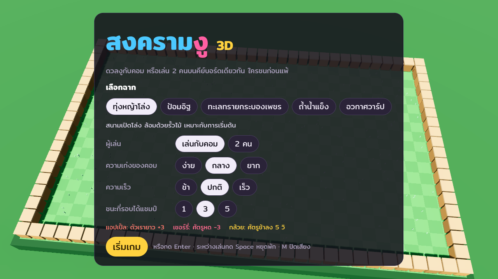
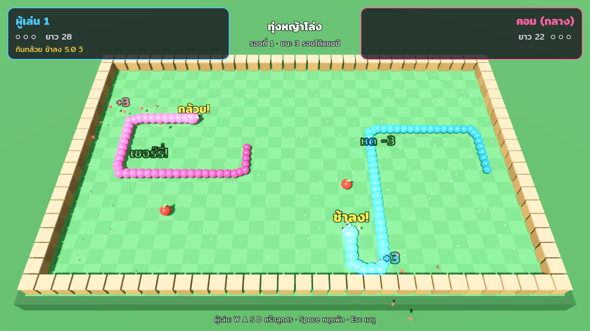
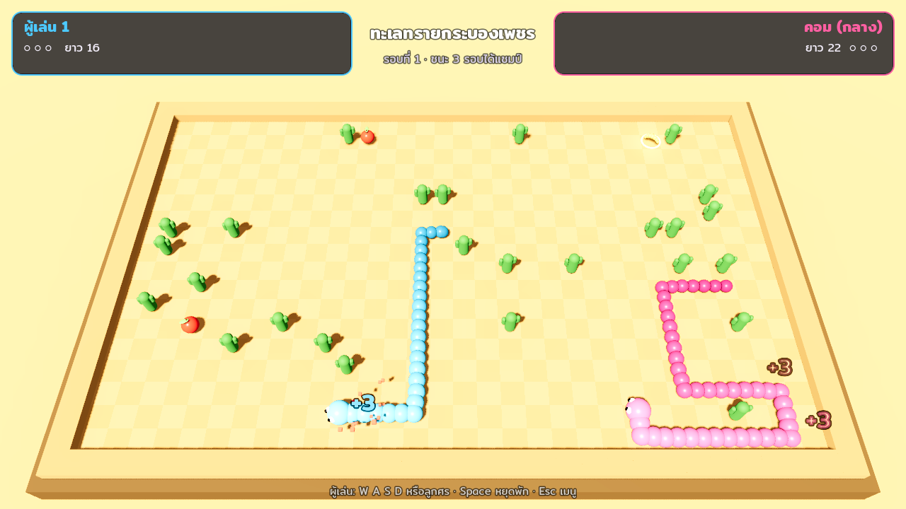
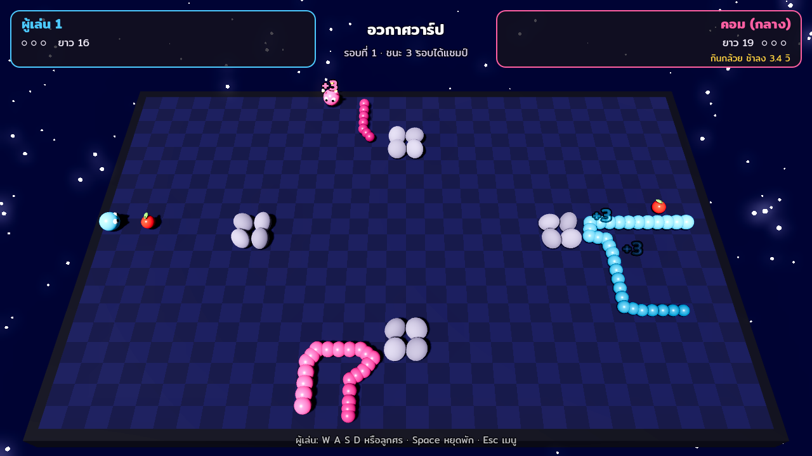

# สงครามงู 3D (Godot)

เวอร์ชัน 3 มิติของสงครามงู ทำด้วย **Godot 4.3** กติกาเดียวกับเวอร์ชันเว็บ: เล่นกับคอม (ง่าย / กลาง / ยาก), 2 คนบนคีย์บอร์ดเดียว หรือนั่งดูคอมสู้กัน ใครโดนล้อมจนไม่มีทางไปแพ้

## วิธีเปิดเล่น

1. ดาวน์โหลด [Godot 4.3 ขึ้นไป](https://godotengine.org/download) (เวอร์ชันธรรมดา ไม่ต้องใช้ .NET)
2. เปิด Godot กด **Import** แล้วเลือกไฟล์ `godot/project.godot` ในโฟลเดอร์นี้
3. กด **F5** (หรือปุ่ม ▶ มุมขวาบน) เพื่อเล่น

ถ้าอยากได้ไฟล์ .exe ไว้แจกเพื่อน: เมนู Project → Export → Add… → Windows Desktop (ครั้งแรก Godot จะให้ดาวน์โหลด export templates)

## ปุ่มควบคุม

| | ผู้เล่น 1 | ผู้เล่น 2 |
|---|---|---|
| บังคับงู | W A S D | ปุ่มลูกศร |

โหมดเล่นกับคอม ใช้ได้ทั้ง W A S D และลูกศร · `Enter` เริ่ม/รอบต่อไป · `Space` หยุดพัก · `Esc` กลับเมนู · `M` ปิดเสียง

## ไอเทม

- 🍎 แอปเปิ้ล: ตัวเรายาวขึ้น 3 ช่อง
- 🍒 เชอร์รี่: ศัตรูหดสั้นลง 3 ช่อง
- 🍌 กล้วย: ศัตรูช้าลงครึ่งหนึ่ง 5 วินาที

## ฉาก

ทุ่งหญ้าโล่ง · ป้อมอิฐ · ทะเลทรายกระบองเพชร · ถ้ำน้ำแข็ง · อวกาศวาร์ป (ทะลุขอบจอได้)

## โครงสร้างโค้ด

- `scripts/logic.gd` กติกาเกม การชน ผลไม้ และ AI ของคอม (ไม่มี node ทดสอบแยกได้)
- `scripts/main.gd` สร้างฉาก 3D เมนู HUD เสียง และรับปุ่มกด ทุกอย่างสร้างด้วยโค้ด ไม่ต้องใช้ไฟล์โมเดลภายนอก
- `fonts/` ฟอนต์ Mitr (SIL Open Font License, ดู `fonts/OFL.txt`)

ทดสอบอัตโนมัติ: `godot --path godot -- --autoplay --stage=0 --shot=/tmp/shot.png` จะให้คอมสู้กันเองแล้วบันทึกภาพหน้าจอ
